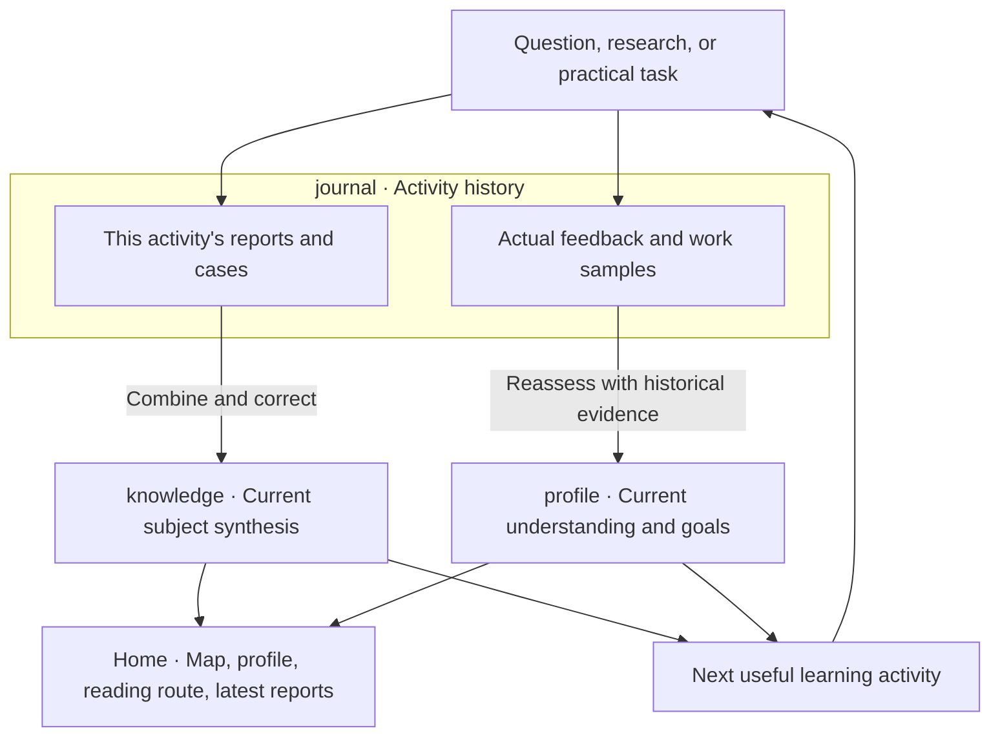

# CogniRings

**English** | [简体中文](i18n/README.zh-CN.md)

**Grow your knowledge. Keep the story of how you learned.**

CogniRings (知年轮) is an AI mentoring skill for Codex. It connects guided dialogue, recent research, practical feedback, and ideas across disciplines to build a knowledge tree around your real questions.

Your archive has three readable views: **knowledge** explains what has been learned about a subject, **profile** describes your current understanding with evidence, and **journal** preserves the reports and personal feedback from each activity. Collected material does not imply mastery.

[Why CogniRings](#why-cognirings) · [Get started](#get-started) · [How it works](#how-it-works) · [Your learning archive](#your-learning-archive) · [Local tooling](#local-tooling) · [License](#license)

## Why CogniRings

We often ask how to make AI more human, or even more capable than we are. At the same time, another question deserves our attention: **how can we grow as people in this changing world?**

CogniRings aims to help you grow like a tree: deepen your roots by understanding how things work, branch out by connecting ideas across fields, and develop your own judgment through questions, practice, and reflection. As your understanding deepens, your judgment evolves, and you learn through practice, these changes gradually form **rings of understanding**, a record you can return to and build on.

## What it helps you do

- Enter an unfamiliar field with a map of its questions, prerequisites, and connections.
- Follow industry changes through dated, sourced reports organized by topic.
- Understand mechanisms, compare choices, and examine assumptions and counterexamples.
- Apply methods from another discipline while checking where the connection holds.
- See your current goals, evidence of understanding, remaining questions, and meaningful changes over time.

AI is an included starting domain. Other fields grow their own structure around your work and interests.

## Get started

### Install with one request

Send this to Codex:

```text
Use $skill-installer to install https://github.com/zakerror/cognirings.
Read the installed SKILL.md and complete its dependency setup automatically.
```

The skill entrypoint is at the repository root. The agent installs CogniRings, reuses an existing [last30days](https://github.com/mvanhorn/last30days-skill) installation or installs the original dependency if missing, and checks the runtime. You do not need a second installation request. Manual installations receive the same check on first use; avoid keeping duplicate installations of the skill.

Use a Codex environment with local skills, filesystem access, and Python. Archive tooling uses the Python standard library and macOS/Linux file locks; native Windows is not supported. The dependency setup checks for Python 3.12+ and follows upstream runtime instructions when needed. Optional research sources can require their own credentials. Setup does not sign you up for services or log in to sources; unavailable coverage is reported. See [installation details](references/installation.md).

### Start with a real question

```text
Use $cognirings to help me prepare an internal AI sharing session
for an engineering team. Start with a knowledge tree, then explore
capability changes and practical applications. Respond in English.
```

Continue with feedback:

```text
Use $cognirings to review my model-selection experiment.
Compare my reasoning with earlier evidence, update my current profile,
and preserve this activity's report and feedback in my journal.
```

You can say “explain directly,” “show me the news first,” “give an example,” or “don't save this activity.” The mentor uses questions when the answers would change what happens next.

## How it works



Current knowledge and profile pages synthesize relevant history. They are not pointers to the newest report. A new report can deepen the knowledge archive while your understanding remains uncalibrated until there is personal evidence.

### Choose the right learning activity

The mentor can act as a guide for **mapping**, an expert for **frameworks**, a coach for **patterns**, a mentor for **decisions**, a partner for **practice**, a **reviewer**, a student for **teaching**, or a collaborator for **transfer and innovation**. Activities can repeat or change order.

Key material identifies its position in the knowledge tree, useful prerequisites, and the activity it supports. Reports can expand through four layers: orientation, recent developments, explanation, and next steps for growth. Each news item keeps dates, the original source, publisher, source category, verification, and limitations.

### Understanding and practice are separate

Understanding uses an explicit working rubric:

- **U — Uncalibrated:** insufficient evidence; this does not mean unable.
- **L1 — Concept awareness:** explain what a concept addresses with material available.
- **L2 — Recognition and restatement:** explain key points and distinguish examples or related concepts.
- **L3 — Independent explanation:** explain mechanisms, conditions, and limitations under follow-up questions.
- **L4 — Derivation and error detection:** reason through unfamiliar cases, correct errors, and give counterexamples.
- **L5 — Teaching and correction:** adapt an explanation to an audience and address misconceptions and questions.

Practical performance is tracked separately: **unverified → assisted completion → independent completion → demonstrated transfer**. Evidence records the actual work, whether it was observed or self-reported, assistance, task scope, and date. Reading a report or publishing AI-generated material does not establish a level.

Goals use concrete checkpoints, such as “2 of 4 checks have evidence; 2 remain unverified.” This is evidence coverage, not a mastery percentage. Levels are a mentoring convention, not a validated psychological scale. See the [mentoring rules](references/mentoring.md).

### Recent research with last30days

Recent research is delegated to the original last30days skill. CogniRings adds primary-source verification, foundational explanations, cross-domain connections, and personal context. It does not bundle, modify, or reimplement upstream research logic.

Public searches receive generalized research questions; personal profiles and internal source material stay out of search queries. Failed, unconfigured, and empty sources are distinguished. Supplementary searches are attributed separately. A consultation can also proceed without recent research.

## Your learning archive

The homepage starts with the global knowledge tree, current profile, suggested reading, and the latest **10 published reports**. Maintenance changes, refreshed navigation, and duplicate report versions do not enter that list.

```text
CogniRings/
├── README.md                            # Global map, current profile, reading route, latest 10 reports
├── knowledge/                           # Current accumulated knowledge; inclusion does not mean mastery
│   ├── README.md                        # All established domains and proposed connections
│   └── ai/
│       ├── README.md                    # Complete AI subtree and domain synthesis
│       └── evaluation/
│           ├── README.md                # Branch synthesis: problems, methods, and choices
│           └── judge-reliability/
│               ├── README.md            # Current conclusions, mechanisms, limits, and open questions
│               ├── methods.md           # Optional comparison of methods and selection conditions
│               ├── cases.md             # Optional cumulative case analysis
│               ├── sources.md           # Sources, purpose, limitations, and access conditions
│               └── reading.md           # Links to original reports in journal
├── profile/                             # Current personal synthesis; same topic paths as knowledge
│   ├── README.md                        # Goals, background, preferences, evidence, and gaps
│   ├── history.md                       # Meaningful changes with links to the original records
│   └── ai/evaluation/judge-reliability/
│       ├── README.md                    # Understanding, practice, scope, target, and next step
│       ├── evidence.md                  # Optional explanation of evidence supporting the current view
│       └── goals.md                     # Optional detailed goals and observable checkpoints
├── journal/                             # Dated final outputs and actual personal feedback
│   ├── README.md                        # Human-readable timeline
│   └── <timestamp>-<topic>/
│       ├── README.md                    # This activity's question, outcomes, and routes
│       ├── synthesis.md                 # Optional complete report spanning several topics
│       ├── knowledge/ai/evaluation/judge-reliability/report.md
│       │                                # Single original of this activity's topical report
│       └── profile/ai/evaluation/judge-reliability/reflection.md
│                                        # Understanding and feedback at the time, with assistance
└── .cognirings/                          # Agent maintenance area, separate from reading material
    ├── archive.json                     # Archive version and identity
    ├── registry/                        # Stable node, artifact, source, and journal identities
    ├── evidence/                        # Structured references to actual personal evidence
    ├── state/                           # Derived metrics and navigation state
    ├── research/                        # Research coverage and verification work
    ├── work/                            # Drafts; private working material is excluded from publishing
    ├── maintenance/                     # Migrations, publication, and layout changes
    └── archive/                         # Preserved legacy material when migrating
```

This illustrates the structure, not a checklist of files to create. Add documents when they have useful content. Each topic and branch README contains a real synthesis as well as navigation. A journal entry contains only the branches touched that time, rather than full copies of the current trees.

Leaf nodes show substantive knowledge update dates, unique report/case/share counts, understanding and evidence dates, and goal checkpoints. Parent nodes show coverage and distributions rather than average levels. Stable IDs survive directory moves; only prerequisite relationships must be acyclic. Cross-domain concepts retain their original identity.

The default location is `~/Documents/CogniRings`, separate from skill code. Specify another path in conversation or use `COGNIRINGS_HOME`. Archives remain local unless you authorize publication. Hidden folders are not a privacy boundary: publishing must exclude private drafts, credentials, internal material, and runtime logs.

## Local tooling

Everyday use happens through conversation. Agents and developers can run these commands from the repository root:

```bash
python3 scripts/archive.py init --root "$HOME/Documents/CogniRings" --person-name "Me"
python3 scripts/archive.py status --root "$HOME/Documents/CogniRings"
python3 scripts/archive.py validate --root "$HOME/Documents/CogniRings"
python3 scripts/archive.py refresh --root "$HOME/Documents/CogniRings"
```

`init` creates a v2 archive. `status` and `validate` are read-only. `refresh` rebuilds generated navigation and metrics while preserving hand-written synthesis. The CLI requires explicit `--root`; the skill resolves the default path.

Prepare a v2 bundle using the [archive contract](references/archive-contract.md), then append it:

```bash
python3 scripts/archive.py record --root "$HOME/Documents/CogniRings" --bundle bundle.json
```

`record` rejects an existing journal ID. The mentor then integrates relevant knowledge and personal evidence into the current pages; scripts do not infer understanding. Existing v1 archives remain readable with `status` and `validate`; `commit` is retained for v1 only. Use `scripts/migrate_v1.py` for an explicit migration into a new directory, then review the current syntheses. Do not initialize over an old archive.

Validate the tooling:

```bash
python3 -m unittest discover -s scripts -p 'test_*.py' -v
```

Tests cover archive and dependency behavior; personal learning still requires real evidence. The package provides skill instructions and local Markdown/Mermaid/JSON tooling. It does not include a standalone web application or automatic research scheduler.

## Design references

[last30days](https://github.com/mvanhorn/last30days-skill) supplies recent research. [grill-me](https://github.com/RobMitt/grill-me-skill), [Universal Diagnostic Tutor](https://github.com/SenmuuuuW/universal-diagnostic-tutor-skill), and [Supertutor](https://github.com/cskwork/supertutor-skill) informed guided questioning, prerequisite diagnosis, and evidence-aware mentoring. See [design notes](references/design-provenance.md). Reference links do not incorporate external code or licenses.

## License

Original code and accompanying documentation use the [MIT License](LICENSE). External projects retain their own licenses. Personal learning archives and retrieved materials do not automatically acquire this repository's MIT license through use of the skill.
