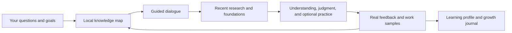

# CogniRings

**English** | [简体中文](i18n/README.zh-CN.md)

**Grow your knowledge. Keep the story of how you learned.**

CogniRings (知年轮) is an AI mentoring skill for Codex. It organizes knowledge around your real questions and uses guided dialogue, recent research, connections across disciplines, and practical feedback to maintain a personal learning profile and learning journal.

Each consultation helps you answer: **Where am I on the knowledge map? What am I adding? How can I check my understanding?**

[Get started](#get-started) · [How it works](#how-it-works) · [Learning archive](#learning-archive) · [License](#license)

## What you can use it for

| Your goal | How CogniRings helps |
| --- | --- |
| Explore an unfamiliar field | Build a local knowledge map and identify prerequisites and key questions |
| Follow changes in an industry | Organize recent developments by topic, with dates, sources, changes, and relevance |
| Develop judgment from what you read | Explain mechanisms, assumptions, trade-offs, and counterexamples |
| Find methods in other disciplines | Connect a method to your problem and explain when the connection holds or breaks |
| See how your understanding develops | Preserve evidence of skills, real feedback, knowledge maps, and past reports |

AI is the included example domain, with four starting points: model developments, application engineering, evaluation and optimization, and source assessment. Other domains can develop their own structure around your questions.

## How it works



Move between these activities as needed. The mentor usually starts with one question that can change what happens next. If you know the foundations, explore trade-offs and counterexamples. If a concept is unfamiliar, fill in the prerequisites. You can also say “explain directly,” “give me an example,” “show me the news first,” or “don't save this session.”

### Two coordinates for every insight

Key material is labeled with both its **position in the knowledge map** and the **learning activity** it supports.

| Coordinate | Example |
| --- | --- |
| Knowledge position | AI → Evaluation and optimization → Comparability → Pareto frontier |
| Learning activity | Framework building, decision-making, review |
| Connection across disciplines | Model selection → Multi-objective optimization in decision theory |
| Evidence you could produce | Explain whether two results are comparable and justify a choice |

Learning activities include mapping, framework building, pattern recognition, decision-making, practice, review, teaching, and transfer/innovation. You can move between them. They help select an approach to learning; they are not a universal ladder or a score for the learner.

### Reports with layers of depth

1. **Orientation:** Where the question sits and why these topics come first.
2. **Developments:** Items grouped by topic, with dates, original links, source categories, publishers, and verification status.
3. **Understanding:** Mechanisms, examples, prerequisites, limitations, and connections to other disciplines.
4. **Growth:** What the session provided, what feedback actually occurred, and how to check understanding next.

## Relationship with last30days

[last30days](https://github.com/mvanhorn/last30days-skill) is an independent dependency for recent research. CogniRings handles mentoring, knowledge organization, and learning records. When recent information is needed, it delegates to the original last30days skill, then adds primary-source verification, foundational material, and connections across disciplines.

| Component | Responsibility |
| --- | --- |
| last30days | Recent research, source handling, and research output |
| CogniRings | Goal setting, guided questions, knowledge maps, layered explanations, feedback, and archives |

This repository does not bundle or modify the last30days implementation. A single setup request installs CogniRings and handles its dependency checks: an existing last30days installation is reused, and a missing one is installed from the original repository. The two components remain independently maintained. Source coverage, credentials, and costs follow the installed upstream version and your host environment. Unavailable sources are disclosed, and supplementary searches are attributed separately.

Sessions that do not need recent research can focus on explanations, organizing knowledge, or reviewing feedback.

## Get started

### Requirements

- A Codex environment that can load local skills, read and write files, and run Python.
- The archive tool uses the Python standard library and targets macOS/Linux. This repository has been validated with Python 3.14. Native Windows is not currently supported because the script uses `fcntl` file locks.
- The agent handles the last30days dependency during setup and checks for Python 3.12+. If the runtime needs attention, it follows the upstream setup instructions and retries when possible. Optional research sources can require their own credentials.
- Other agent hosts require their own skill discovery, tool, and dependency integration. Compatibility with those hosts has not been verified here.

### Install with one request

Send this single request to Codex:

```text
Use $skill-installer to install https://github.com/zakerror/cognirings.
Read the installed SKILL.md and complete its dependency setup automatically.
```

The agent installs the skill from the repository root, reuses an existing last30days installation or installs the original dependency if missing, and checks the runtime before reporting the result. There is no separate dependency-installation step for you.

The same check runs on first use after a manual installation. If you copy the repository to `~/.agents/skills/cognirings/`, keep `SKILL.md` directly inside that folder and avoid duplicate installations. See the [official OpenAI skills documentation](https://learn.chatgpt.com/docs/build-skills) for local skill discovery.

Dependency setup does not sign you up for paid services or log in to optional sources. Research-time source checks still follow last30days. If network access, permissions, or a required runtime prevent completion, the agent reports the specific blocker rather than claiming setup succeeded.

### Start a consultation

```text
Use $cognirings to help me build a knowledge tree for AI.
I'm interested in model developments, application engineering,
evaluation and optimization, and useful websites.
Start with my actual work and how I make decisions, then identify
which knowledge to explore. Respond in English.
```

Continue an existing domain:

```text
Use $cognirings to continue my AI knowledge tree.
This time, focus on model selection and check whether I'm overlooking
cost, latency, or differences in evaluation protocols.
```

Explore a connection across disciplines:

```text
Use $cognirings to explain what AI judge consistency can learn
from measurement theory. Explain the connection and where it breaks down.
```

Record feedback from real work:

```text
Use $cognirings to review this experiment.
Update my learning profile and Storybook using the actual results,
while preserving the earlier snapshots.
```

## Learning archive

Each domain maintains a current learning profile and knowledge map, along with a complete historical snapshot of every saved consultation:

```text
Me
├── Domain A
│   ├── Current learning profile
│   ├── Current knowledge map
│   └── Growth history
│       └── Profile, knowledge map, Storybook, and report for each session
└── Domain B
    └── Maintained separately, with supported connections to other domains
```

The tree provides navigation; the underlying structure retains graph relationships. Prerequisites must be acyclic, while analogies, applications, comparisons, and connections across domains can form a network.

### Evidence drives profile updates

| Status | Meaning |
| --- | --- |
| Not yet verified | There is no evidence yet; this does not imply a lack of ability |
| Confirmed exposure | You confirm reading or hearing about something; mastery is not established |
| Self-reported | Your own description is preserved with its source |
| Demonstrated | An answer, analysis, or work sample supports a claim within the scope checked |

Assistance is recorded separately: completing something with hints provides different evidence from completing it independently. The Storybook preserves actual questions, feedback, and changes in understanding. If feedback has not happened, it stays explicitly unrecorded.

### Where files live

The default archive location is `~/Documents/CogniRings`, separate from the skill's code. You can specify another directory in conversation or make `COGNIRINGS_HOME` available to the skill through your host.

```text
CogniRings/
├── person.json
├── INDEX.md
└── domains/<domain-id>/
    ├── current.json
    └── sessions/<session-id>/
        ├── bundle.json
        ├── profile.json / profile.md
        ├── architecture.json / architecture.md
        ├── session.json / storybook.md
        └── report.md
```

Each save writes a new snapshot before updating the current pointer. A submission cannot overwrite an existing session with the same ID. Personal archives are stored locally by default, and public searches use generalized technical questions. Model processing and network behavior still depend on your agent host.

## Local archive tool

Everyday use happens through conversation. The following CLI commands are for agents and developers managing the archive. Run them from the repository root:

```bash
python3 scripts/archive.py init --root "$HOME/Documents/CogniRings" --person-name "Me"
python3 scripts/archive.py status --root "$HOME/Documents/CogniRings"
python3 scripts/archive.py validate --root "$HOME/Documents/CogniRings"
```

Prepare a `bundle.json` according to the [archive contract (Chinese)](references/archive-contract.md), then commit it:

```bash
python3 scripts/archive.py commit --root "$HOME/Documents/CogniRings" --domain ai --bundle bundle.json
```

The CLI always requires an explicit `--root`; `COGNIRINGS_HOME` is a convention followed by the skill. `status` is read-only. `validate` checks the archive and rebuilds `INDEX.md`. The script does not determine whether a learner has mastered a concept.

## Repository layout and validation

```text
cognirings/
├── README.md
├── i18n/README.zh-CN.md
├── DESCRIPTION.txt
├── LICENSE
├── SKILL.md
├── agents/openai.yaml
├── references/
│   ├── installation.md
│   ├── mentoring.md
│   ├── archive-contract.md
│   ├── research-adapter.md
│   ├── ai-domain.md
│   └── design-provenance.md
└── scripts/
    ├── archive.py
    ├── ensure_dependencies.py
    ├── test_archive.py
    └── test_dependencies.py
```

Run the archive and dependency tests:

```bash
python3 -m unittest discover -s scripts -p 'test_*.py' -v
```

The tests cover archive history, failure recovery, concurrent commits, source references, and dependency installation and reuse. They validate tooling behavior. Learning outcomes still require evidence from actual use and work. See the [installation notes (Chinese)](references/installation.md) for the agent-facing setup contract.

The current package contains skill instructions and a local archive tool. Knowledge maps are stored as Markdown, Mermaid, and JSON. It does not include a standalone web application, cloud synchronization, or an automatic research scheduler.

## Design references

- [last30days](https://github.com/mvanhorn/last30days-skill): Independent recent-research dependency.
- [grill-me](https://github.com/RobMitt/grill-me-skill): One key question at a time and interviews guided by dependencies.
- [Universal Diagnostic Tutor](https://github.com/SenmuuuuW/universal-diagnostic-tutor-skill): Prerequisite gaps and diagnostic guidance.
- [Supertutor](https://github.com/cskwork/supertutor-skill): Distinguishing assisted from independent performance and checking understanding in new situations.

See the [design notes (Chinese)](references/design-provenance.md) for specific influences and boundaries. Linking to a reference project does not incorporate its code or license into this repository.

## License

This repository uses the [MIT License](LICENSE) for its original code and accompanying documentation. Use, modification, redistribution, and commercial use are permitted, subject to retaining the copyright and permission notice. No warranty is provided. See LICENSE for the full terms.

last30days and other external projects retain their own licenses. Personal learning archives, retrieved material, and external web pages do not automatically acquire this repository's MIT license through use of the skill.
