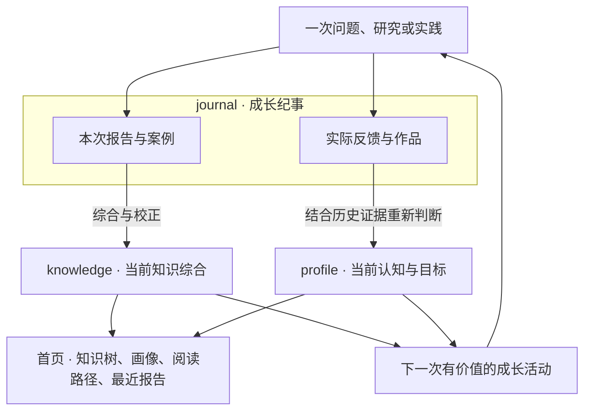

# 知年轮 · CogniRings

[English](../README.md) | **简体中文**

**让每次探索长出知识分枝，让每次理解留下成长年轮。**

知年轮是面向 Codex 的 AI 成长导师技能。它围绕你的真实问题，通过引导式对话、近期研究、实践反馈和跨领域方法，逐步建立个人知识树。

档案有三个阅读入口：**knowledge 知识体系**整理这个领域已积累的内容，**profile 认知画像**依据证据描述你当前的理解，**journal 成长纪事**保存每次活动的报告与真实反馈。收录知识不代表已经掌握。

[开始使用](#开始使用) · [工作方式](#工作方式) · [成长档案](#成长档案) · [本地工具](#本地工具) · [许可证](#许可证)

## 它能帮助你做什么

- 进入陌生领域时，先看问题空间、前置知识与主题关系。
- 按主题持续了解行业变化，保留时间、来源和相关性。
- 理解机制、比较方案、检查假设和反例。
- 借鉴其他学科的方法，并确认成立条件与失效边界。
- 看见当前目标、理解证据、尚待确认的问题与成长中的重要变化。

AI 是内置的起始领域。其他领域可以围绕你的工作和兴趣建立自己的结构。

## 开始使用

### 一次请求，完成安装

向 Codex 发送：

```text
请用 $skill-installer 安装 https://github.com/zakerror/cognirings。
读取安装后的 SKILL.md，并自动完成其中的依赖安装与检查。
```

技能入口位于仓库根目录。Agent 会安装知年轮，复用已有的 [last30days](https://github.com/mvanhorn/last30days-skill)，或自动补齐缺失的原版依赖，并检查运行环境。你不需要再提出一次依赖安装请求。手动安装后，首次使用也会执行同样的检查；避免重复安装同名技能。

需要支持本地技能、文件读写和 Python 的 Codex 环境。档案工具使用 Python 标准库和 macOS/Linux 文件锁，暂不支持原生 Windows。依赖安装检查 Python 3.12+，必要时按上游运行时说明处理。可选研究来源可能需要各自凭据；安装不会替你注册服务或登录来源，不可用覆盖会明确说明。详见 [安装与自检](../references/installation.md)。

### 从真实问题开始

```text
用 $cognirings 帮我准备面向工程研发团队的 AI 内部分享。
先建立知识树，再围绕能力变化与实践扩展内容。
```

用实际反馈继续：

```text
用 $cognirings 复盘我的模型选型实验。
结合之前的证据检查我的推理，更新当前画像，
并把这次报告和真实反馈保存在成长纪事中。
```

你可以随时说“直接讲”“先看资讯”“举个例子”或“这次不记档”。导师只在答案会改变下一步时提问。

## 工作方式



当前知识与画像综合相关历史，不指向最新一份报告就算完成。新报告可以增加知识厚度；你的理解需要个人证据才能校准。

### 选择合适的成长活动

导师可以在**地图中的导游、框架中的专家、模式中的教练、决策中的师傅、实践中的搭档、审查中的 Reviewer、教学中的学生、迁移与创新中的合作者**之间切换。活动可以反复或调整顺序。

重点内容标明知识位置、必要前置和本轮成长活动。报告可以逐层展开为导航、近期事项、机制解释、成长下一步。资讯保留日期、原文链接、发布者、来源类别、核验情况与局限。

### 理解与实践分别记录

理解采用明确的工作量规：

- **U · 未校准**：证据不足，不代表不会。
- **L1 · 概念认知**：借助材料说明概念解决什么问题。
- **L2 · 辨识与复述**：说明要点，区分实例和相近概念。
- **L3 · 独立解释**：解释机制、条件和边界，回应变化的追问。
- **L4 · 推导与辨错**：分析陌生案例、修正错误、给出有效反例。
- **L5 · 教学与纠错**：面向听众组织解释，回应追问并纠正误区。

实践独立记录为**未验证 → 辅助完成 → 独立完成 → 已验证跨情境迁移**。证据保留实际作品或反馈、自述还是观察、辅助程度、任务范围与时间。读过一份报告、发布 AI 生成的材料，都不自动获得等级。

目标使用具体检查点，例如“4 项中 2 项有证据，2 项待验证”。它表示证据覆盖，不换算成掌握百分比。这是导师工作约定，不声称为经过验证的心理量表。详见 [导师规则](../references/mentoring.md)。

### 由 last30days 执行近期研究

近期研究委托原版 last30days。知年轮补充一手核验、基础解释、跨领域联系和个人背景，不包含、修改或重写上游检索实现。

公开检索只接收抽象后的研究问题；个人画像和内部原文不进入查询。来源失败、未配置和成功但无结果分别记录，补充搜索单独归因。没有近期研究需要时，也可以专注讲解或复盘。

## 成长档案

首页先展示全局知识树、当前画像、推荐阅读和最近 **10 份已发布报告**。维护调整、导航刷新与同一报告的重复版本不占据这个入口。

```text
CogniRings/
├── README.md                            # 全局知识树、当前画像、阅读路径、最近10份报告
├── knowledge/                           # 当前知识体系；收录不代表掌握
│   ├── README.md                        # 所有已建立领域与候选跨域联系
│   └── ai/
│       ├── README.md                    # AI完整子树与领域综合
│       └── evaluation/
│           ├── README.md                # 分支综合：问题类别、方法关系与选择条件
│           └── judge-reliability/
│               ├── README.md            # 当前结论、机制、边界与开放问题
│               ├── methods.md           # 按需建立：方法比较与使用条件
│               ├── cases.md             # 按需建立：案例综合分析
│               ├── sources.md           # 来源用途、局限与访问条件
│               └── reading.md           # 指向journal中原始报告的阅读入口
├── profile/                             # 当前个人综合；主题路径与knowledge一致
│   ├── README.md                        # 目标、背景、偏好、理解证据与主要缺口
│   ├── history.md                       # 重要变化提炼，链接当时记录
│   └── ai/evaluation/judge-reliability/
│       ├── README.md                    # 理解、实践、范围、目标与下一步
│       ├── evidence.md                  # 按需建立：说明当前判断所依据的证据
│       └── goals.md                     # 按需建立：详细目标与可观察检查点
├── journal/                             # 按时间保存正式成果与真实个人反馈
│   ├── README.md                        # 面向人的成长时间线
│   └── <时间>-<主题>/
│       ├── README.md                    # 本次问题、成果和阅读入口
│       ├── synthesis.md                 # 可选：跨多个主题的完整报告
│       ├── knowledge/ai/evaluation/judge-reliability/report.md
│       │                                # 本次专题报告的唯一原文
│       └── profile/ai/evaluation/judge-reliability/reflection.md
│                                        # 当时的理解、实际反馈与辅助程度
└── .cognirings/                          # Agent维护区，与日常阅读内容分开
    ├── archive.json                     # 档案版本与身份
    ├── registry/                        # 节点、成果、来源和纪事的稳定身份
    ├── evidence/                        # 指向真实个人表现的结构化证据
    ├── state/                           # 派生指标与导航状态
    ├── research/                        # 研究覆盖、核验与过程材料
    ├── work/                            # 草稿；私密工作材料排除发布
    ├── maintenance/                     # 迁移、发布与结构调整记录
    └── archive/                         # 迁移时保留的旧格式资料
```

这是结构示例，不是必须填满的文件清单。文档有内容价值时才建立；每层 README 同时提供真实综合和导航。一次纪事只包含当次涉及的分支，不复制整棵当前知识树和画像。

叶子显示知识实质更新时间、去重后的报告/案例/分享数量、理解与证据日期、目标检查点。父节点显示覆盖与分布，不平均等级。节点使用稳定 ID，移动目录后仍能关联历史；仅前置依赖必须无环，跨域概念保留原学科身份。

默认目录为 `~/Documents/CogniRings`，与技能代码分开。可在对话中指定路径，或提供 `COGNIRINGS_HOME`。没有发布授权时档案保存在本地。隐藏目录不等于隐私保护：发布时仍需排除私密草稿、凭据、内部材料及运行日志。

## 本地工具

日常使用通过对话完成。Agent 或开发者可在仓库根目录运行：

```bash
python3 scripts/archive.py init --root "$HOME/Documents/CogniRings" --person-name "我"
python3 scripts/archive.py status --root "$HOME/Documents/CogniRings"
python3 scripts/archive.py validate --root "$HOME/Documents/CogniRings"
python3 scripts/archive.py refresh --root "$HOME/Documents/CogniRings"
```

`init` 创建 v2 档案。`status` 与 `validate` 只读；`refresh` 重建派生导航和统计，保留手写综合。CLI 要求显式 `--root`，默认路径由技能确定。

按 [档案契约](../references/archive-contract.md) 准备 v2 bundle 后追加本次记录：

```bash
python3 scripts/archive.py record --root "$HOME/Documents/CogniRings" --bundle bundle.json
```

`record` 拒绝覆盖已有纪事 ID。导师随后把相关知识与个人证据综合到当前页面；脚本不推断理解。v1 档案仍可用 `status` 和 `validate` 读取，`commit` 仅用于 v1。使用 `scripts/migrate_v1.py` 显式迁移到新目录后，需要核对并整理当前综合，不能用初始化覆盖旧档案。

验证工具行为：

```bash
python3 -m unittest discover -s scripts -p 'test_*.py' -v
```

测试覆盖档案与依赖行为，个人成长仍需要真实证据。本项目提供技能指令和本地 Markdown/Mermaid/JSON 工具，不包含独立 Web 应用或自动研究调度服务。

## 设计参考

[last30days](https://github.com/mvanhorn/last30days-skill) 提供近期研究能力。[grill-me](https://github.com/RobMitt/grill-me-skill)、[Universal Diagnostic Tutor](https://github.com/SenmuuuuW/universal-diagnostic-tutor-skill)、[Supertutor](https://github.com/cskwork/supertutor-skill) 分别为引导提问、前置诊断和基于证据的辅导提供参考。具体影响见 [设计依据](../references/design-provenance.md)；参考链接不意味着并入外部代码或许可。

## 许可证

原创代码和随附文档采用 [MIT License](../LICENSE)。外部项目保留各自许可证。个人档案及检索材料不因使用本技能而自动获得本仓库的 MIT 许可。
