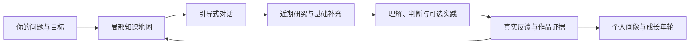

# 知年轮 · CogniRings

[English](../README.md) | **简体中文**

**让每次探索长出知识分枝，让每次理解留下成长年轮。**

A knowledge-map-driven AI mentor for guided discovery, cross-domain learning, and a personal learning story.

知年轮是一个面向 Codex 的成长导师技能。它围绕你的实际问题组织知识地图，通过引导式对话、近期研究、跨领域连接与实践反馈，持续维护个人能力画像和学习记录。

每次咨询都帮助你回答：**我在知识地图的哪里？这次补充了什么？下一步怎样验证自己的理解？**

[开始使用](#开始使用) · [工作方式](#工作方式) · [成长档案](#成长档案) · [许可证](#许可证)

## 适合用来做什么

| 你的目标 | 知年轮提供什么 |
| --- | --- |
| 进入一个不熟悉的领域 | 展开局部知识地图，补充前置概念与关键问题 |
| 持续了解行业变化 | 按主题整理近期事项，说明时间、来源、变化与相关性 |
| 从新闻走向判断 | 解释机制、适用条件、取舍与反例 |
| 寻找跨领域方法 | 建立原学科与当前问题之间的连接，写清成立条件和边界 |
| 看见自己的成长 | 保存有证据的能力变化、真实反馈、知识架构与历史报告 |

AI 是内置的示例领域，包含模型动向、应用工程、评测优化和来源判断四个入口。其他领域可以按问题建立自己的结构。

## 工作方式



这些环节可以按需要切换。通常先问一个能改变下一步的问题；已经熟悉基础，就进入取舍与反例；遇到陌生概念，就补前置知识。你也可以随时说“直接讲”“举个例子”“先看资讯”或“这次不记档”。

### 一条资讯，两条坐标

每条重点材料既标注**知识位置**，也标注**成长活动**。

| 坐标 | 示例 |
| --- | --- |
| 知识位置 | AI → 评测与优化 → 可比性 → 帕累托前沿 |
| 成长活动 | 框架、决策、审查 |
| 跨域连接 | 模型选型 → 决策理论中的多目标优化 |
| 可以留下的证据 | 说明两组结果能否比较，并给出取舍依据 |

成长活动包括地图、框架、模式、决策、实践、审查、教学、迁移/创新，可以交替发生。它们用于选择学习方式，不构成统一等级或个人总分。

### 分层报告

1. **导航层**：本次问题位于哪里，为什么先看这些。
2. **资讯层**：按主题列出事项，保留日期、原链接、来源大类、发布者与核验情况。
3. **理解层**：解释机制、实例、前置知识、适用边界和跨域联系。
4. **成长层**：说明本轮提供了什么、有什么实际反馈，以及下一步可以怎样验证。

## 与 last30days 的关系

[last30days](https://github.com/mvanhorn/last30days-skill) 是独立的近期研究依赖。知年轮负责导师对话、知识组织与成长记录；需要近期信息时，委托原版 last30days，再补充一手核验、基础知识和跨域材料。

| 组件 | 职责 |
| --- | --- |
| last30days | 近期检索、来源处理及其研究输出 |
| CogniRings | 目标定位、引导提问、知识架构、分层解释、反馈与档案 |

本仓库不包含或修改 last30days 的实现。你只需提出一次安装请求，Agent 会安装知年轮并完成依赖检查：已有 last30days 就复用，缺失时从原仓库补齐。两个组件仍独立维护。来源覆盖、凭据和费用遵循所安装的上游版本及宿主环境；来源不可用会明确记录，补充搜索会单独归因。

没有近期检索需求时，可以只进行讲解、知识整理或反馈复盘。

## 开始使用

### 环境

- 能加载本地技能、读写文件并执行 Python 的 Codex 环境。
- 本地归档工具使用 Python 标准库，面向 macOS/Linux；本仓库在 Python 3.14 上验证。原生 Windows 暂未适配，脚本使用 `fcntl` 文件锁。
- Agent 会在安装时处理 last30days 依赖并检查 Python 3.12+；运行时不满足时按上游支持的方法配置或选用解释器，再重试。可选研究来源可能需要各自的凭据。
- 使用其他 Agent 宿主时，需要自行适配技能发现、工具和依赖调用；本仓库未声明这些宿主已经验证。

### 一次请求，完成安装

只需向 Codex 发送这一条请求：

```text
请用 $skill-installer 安装 https://github.com/zakerror/cognirings。
读取安装后的 SKILL.md，并自动完成其中的依赖安装与检查。
```

Agent 会从仓库根目录安装技能，复用已有的 last30days 或自动安装缺失的原版依赖，并在报告结果前检查运行环境。你不需要再执行“安装依赖”这一步。

手动安装也会在首次使用时执行同样的检查。若将仓库复制到 `~/.agents/skills/cognirings/`，确保目录内直接包含 `SKILL.md`，并避免重复安装。技能发现方式参见 [OpenAI 官方技能文档](https://learn.chatgpt.com/docs/build-skills)。

安装过程不会替你注册付费服务或登录可选来源；真正研究前仍按 last30days 进行来源检查。网络、权限或必要运行时确实阻塞时，Agent 会说明具体原因，不会把未完成的安装报成成功。

### 开始一次咨询

```text
用 $cognirings 帮我建立 AI 领域的知识树。
我关心模型动向、应用工程、评测优化和优质网站。
先了解我的实际工作与判断方式，再决定补哪些知识。
```

继续已有领域：

```text
用 $cognirings 继续我的 AI 知识树。
这次围绕模型选型，看看我是否忽略了成本、延迟和评测口径。
```

寻找跨领域方法：

```text
用 $cognirings 帮我理解：AI 评测里的 Judge 一致性，
能从测量论借鉴什么？请说明对应关系和失效边界。
```

保存一次真实反馈：

```text
用 $cognirings 复盘我的这次实验。
请根据实际结果更新能力画像和 Storybook，保留之前的切片。
```

## 成长档案

每个领域维护当前画像与知识架构，同时保留每次咨询的完整历史切片：

```text
我
├── 领域 A
│   ├── 当前能力画像
│   ├── 当前知识架构
│   └── 历史年轮
│       └── 当次画像、知识架构、Storybook、知识报告
└── 领域 B
    └── 独立维护，并与其他领域建立有依据的连接
```

知识树用于导航，底层保留图关系。前置关系需要无环；类比、应用、对比和跨域联系可以成网。

### 能力由证据更新

| 状态 | 含义 |
| --- | --- |
| 尚未验证 | 目前没有证据，不代表不会 |
| 确认接触 | 用户确认读过或听过，尚不能据此判断掌握 |
| 自述掌握 | 保留用户自述及其出处 |
| 有表现证据 | 有实际回答、分析或作品，结论限于验证范围 |

辅助程度另行记录：在提示下完成与独立完成是不同证据。Storybook 保存真实问题、反馈和理解变化；尚未反馈就明确留空。

### 文件放在哪里

默认档案目录为 `~/Documents/CogniRings`，与技能代码分开。可以在对话中指定其他目录，也可以让宿主向技能提供 `COGNIRINGS_HOME`。

```text
CogniRings/
├── person.json
├── INDEX.md
└── domains/<domain-id>/
    ├── current.json
    └── sessions/<session-id>/
        ├── bundle.json
        ├── profile.json / profile.md
        ├── architecture.json / architecture.md
        ├── session.json / storybook.md
        └── report.md
```

每次保存新的切片后更新当前入口，已有历史不会被同名提交覆盖。个人档案默认留在本地；公开检索使用抽象后的技术问题。宿主模型处理与网络行为仍取决于你使用的 Agent 环境。

## 本地归档工具

日常使用通过对话完成。下面的 CLI 供 Agent 或开发者管理档案，在仓库根目录执行：

```bash
python3 scripts/archive.py init --root "$HOME/Documents/CogniRings" --person-name "我"
python3 scripts/archive.py status --root "$HOME/Documents/CogniRings"
python3 scripts/archive.py validate --root "$HOME/Documents/CogniRings"
```

提交前按 [档案契约](../references/archive-contract.md) 准备 `bundle.json`，再执行：

```bash
python3 scripts/archive.py commit --root "$HOME/Documents/CogniRings" --domain ai --bundle bundle.json
```

CLI 始终需要显式传入 `--root`；`COGNIRINGS_HOME` 是技能层的路径约定。`status` 只读，`validate` 会核对档案并重建 `INDEX.md`。脚本不判断用户是否学会了某个概念。

## 仓库结构与验证

```text
cognirings/
├── README.md
├── i18n/
│   └── README.zh-CN.md
├── DESCRIPTION.txt
├── LICENSE
├── SKILL.md
├── agents/openai.yaml
├── references/
│   ├── installation.md
│   ├── mentoring.md
│   ├── archive-contract.md
│   ├── research-adapter.md
│   ├── ai-domain.md
│   └── design-provenance.md
└── scripts/
    ├── archive.py
    ├── ensure_dependencies.py
    ├── test_archive.py
    └── test_dependencies.py
```

运行归档和依赖测试：

```bash
python3 -m unittest discover -s scripts -p 'test_*.py' -v
```

测试覆盖历史保留、失败恢复、并发提交、来源引用，以及依赖安装和复用。测试验证的是工具行为，学习效果仍需要真实使用与产出验证。Agent 执行安装的细节见 [安装与自检](../references/installation.md)。

当前交付是技能指令与本地归档工具。知识地图以 Markdown、Mermaid 和 JSON 保存；不包含独立 Web 应用、云同步或自动定时采集服务。

## 设计参考

- [last30days](https://github.com/mvanhorn/last30days-skill)：独立近期研究依赖。
- [grill-me](https://github.com/RobMitt/grill-me-skill)：一次一个关键问题与依赖式访谈。
- [Universal Diagnostic Tutor](https://github.com/SenmuuuuW/universal-diagnostic-tutor-skill)：前置缺口与诊断式引导。
- [Supertutor](https://github.com/cskwork/supertutor-skill)：区分提示与独立表现，关注新情境应用。

具体借鉴与边界见 [设计依据](../references/design-provenance.md)。参考项目的链接不意味着其代码或许可被并入本仓库。

## 许可证

本仓库采用 [MIT License](../LICENSE)，覆盖本项目的原创代码与随附文档。允许使用、修改、分发及商业使用，须保留版权和许可声明；不提供担保。正式条款以 LICENSE 为准。

last30days 和其他外部项目继续遵循各自许可证。用户学习档案、检索所得材料和外部网页不因使用本技能而自动取得本仓库的 MIT 许可。
